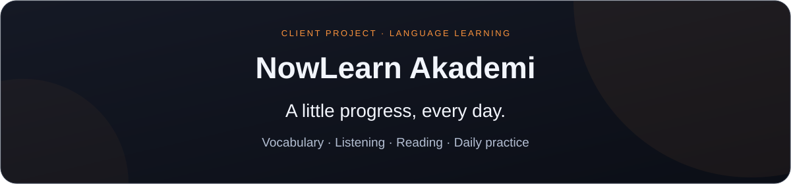

<a href="README.md">English</a> &nbsp; / &nbsp; <a href="README.tr.md">Türkçe</a>

<a href="https://apps.apple.com/tr/app/now-learn-akademi/id6803083436">App Store</a> &nbsp; / &nbsp; <a href="https://play.google.com/store/apps/details?id=com.lingopark.app">Google Play</a> &nbsp; / &nbsp; <a href="https://nowlearnakademi.com/">Website</a>

 

An English learning app I developed for a company using Flutter. Word games, listening and reading exercises turn daily practice into a habit.

Portfolio showcase · Application source and packages are not included

<h2 align="center">Practice in different ways</h2>
<table align="center"><tr><th align="center">Learn</th><th align="center">Practice</th><th align="center">Progress</th></tr><tr><td align="center">Vocabulary games, quizzes and timed challenges.</td><td align="center">Listening exercises and reading passages.</td><td align="center">Levels, XP, badges, daily streaks and account progress.</td></tr></table>
<h2 align="center">Inside the app</h2>

Screenshots from the Google Play listing; some retain the earlier Lingo Park branding. The current product name is NowLearn Akademi.

 &nbsp;  &nbsp; 

More app previews

 &nbsp;  &nbsp; 

<h2 align="center">Development</h2>

<strong>Flutter · Dart · Isar · Flutter TTS · AudioPlayers</strong>

Mobile interface development, local data storage, spoken vocabulary and gamified learning flows.

<h2 align="center">About this repository</h2>

This repository presents my development work. It does not provide source code or APK downloads and is not the company’s official support channel. Use the store and website links above for the product.

No open-source license is granted. Use of the content and visuals requires permission from the relevant rights holders.

 

<a href="https://www.ekrembulgan.com">Ekrem Bulgan</a> &nbsp; / &nbsp; <a href="https://linkedin.com/in/ekrembulgan">LinkedIn</a>

Client project · Portfolio showcase

