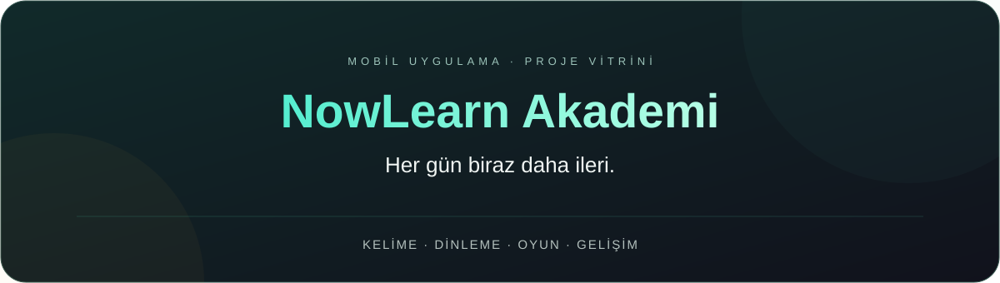
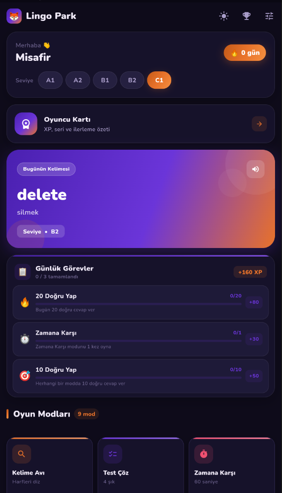
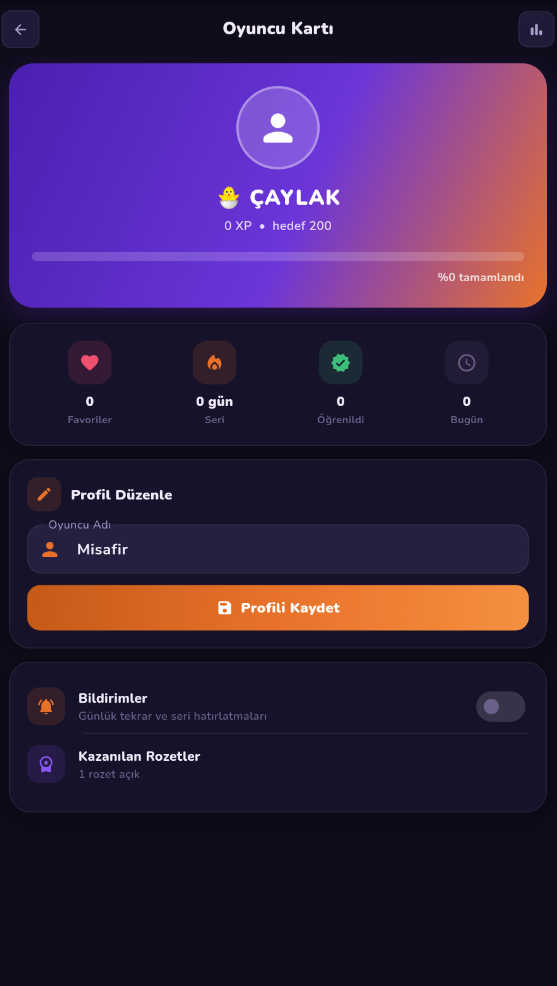
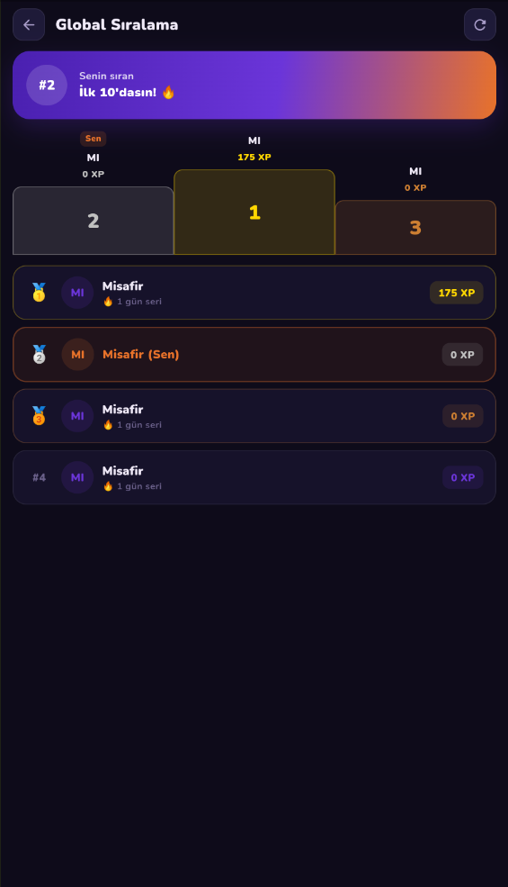
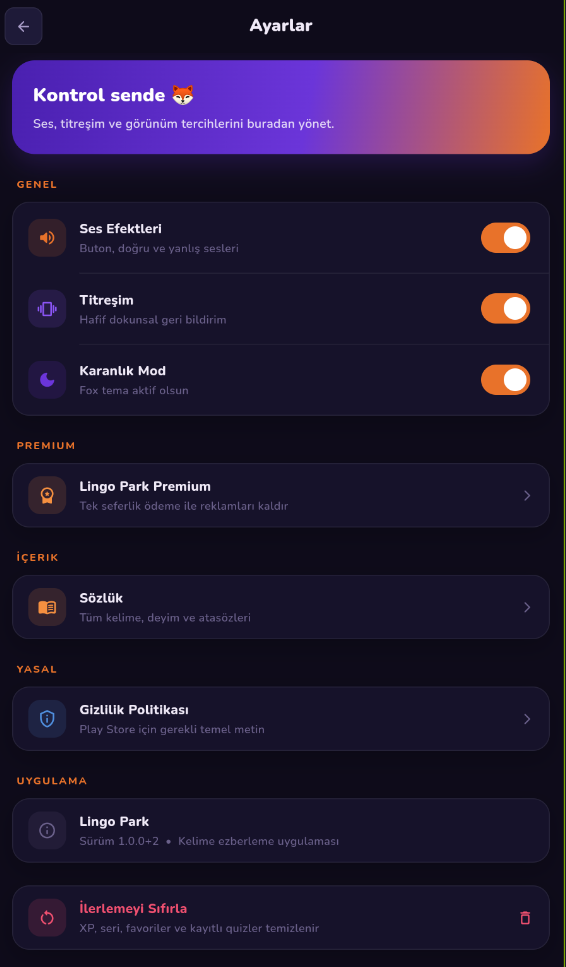
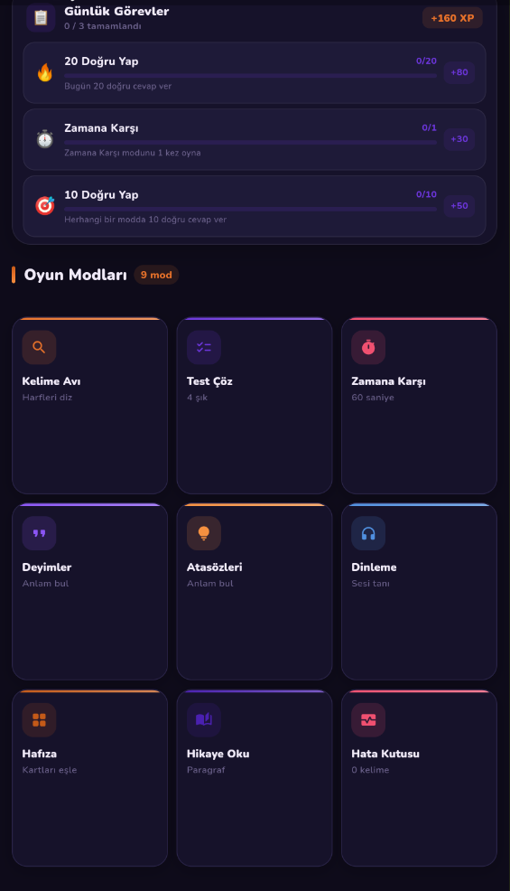
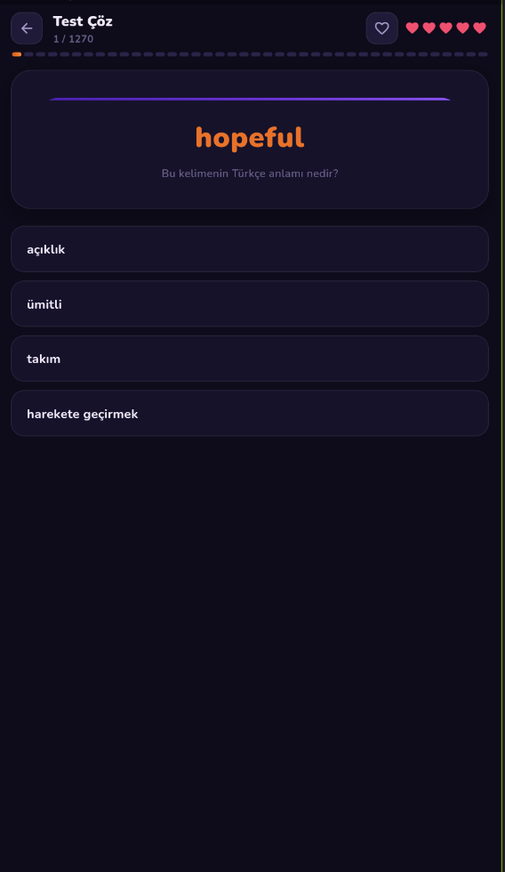

<h1>NowLearn Akademi</h1>

<strong>Kelime öğren. Pratik yap. İlerle.</strong>

İngilizce kelime öğrenimini oyunlar, dinleme ve günlük pratikle buluşturan mobil uygulama.

<a href="https://apps.apple.com/tr/app/now-learn-akademi/id6803083436">App Store’dan indir</a> &nbsp; · &nbsp; <a href="https://play.google.com/store/apps/details?id=com.lingopark.app">Google Play’den indir</a> &nbsp; · &nbsp; <a href="https://nowlearnakademi.com/">NowLearn Akademi web sitesi</a>

<a href="#uygulamadan-goruntuler">Ekran görüntüleri</a> &nbsp; · &nbsp; <a href="https://www.ekrembulgan.com">Portfolyo</a> &nbsp; · &nbsp; <a href="https://linkedin.com/in/ekrembulgan">İletişim</a>

 

Bu uygulamayı bir şirket için geliştirdim. Bu depo, geliştirme çalışmamı ve uygulamanın kullanıcı deneyimini tanıtmak amacıyla hazırlanmıştır.

<strong>Kaynak kodu ve uygulama paketleri bu depoda paylaşılmamaktadır.</strong>

<h2>Öğrenmeyi günlük bir alışkanlığa dönüştürmek</h2>

Kelime oyunları, çoktan seçmeli testler, dinleme alıştırmaları ve okuma parçalarıyla farklı biçimlerde pratik yapmayı amaçlar. Seviye seçimi, XP, rozetler ve günlük seri takibi ilerlemeyi görünür kılar.

<table align="center">
<tr><th>Kelime pratiği</th><th>Dinleme ve okuma</th><th>İlerleme takibi</th></tr>
<tr><td align="center">Kelime avı, test ve zamana karşı oyunlar</td><td align="center">Dinleme testleri ve okuma parçaları</td><td align="center">XP, rozetler ve günlük seri</td></tr>
<tr><th>Hesap ve ilerleme</th><th>Seviyeye göre çalışma</th><th>Görünüm</th></tr>
<tr><td align="center">Profil, favoriler ve bulutta saklanan ilerleme</td><td align="center">A1–C1 seviyelerine yönelik içerikler</td><td align="center">Karanlık tema ve mobil odaklı arayüz</td></tr>
</table>

<h2>Uygulamadan görüntüler</h2>

Görseller Google Play tanıtım sayfasından alınmıştır ve eski “Lingo Park” adını içerebilir. Projenin güncel adı NowLearn Akademi’dir; mağazadaki sürümün görünümü değişebilir.

<table align="center">
<tr><th>Ana ekran</th><th>Oyuncu kartı</th><th>Kelime oyunu</th></tr>
<tr><td></td><td></td><td></td></tr>
</table>

Test, dinleme ve okuma ekranlarını göster

 
<table align="center">
<tr><th>Test</th><th>Dinleme</th><th>Okuma</th></tr>
<tr><td></td><td></td><td></td></tr>
</table>

<h2>Geliştirme</h2>

<strong>Flutter · Dart · Isar · Flutter TTS · AudioPlayers</strong>

Mobil arayüz, yerel veri saklama, sesli kelime okuma ve oyunlaştırılmış öğrenme akışlarını bir araya getiren bir çalışma.

<h2>Proje hakkında</h2>

Bu sayfa bir portfolyo sunumudur. Kaynak kodu ve APK dağıtımı yapmaz; uygulamaya yukarıdaki resmî mağaza bağlantılarından ulaşabilirsin. Şirket adına resmî destek veya duyuru kanalı değildir.

İçerik ve görsellerin kullanımı için ilgili hak sahiplerinin izni gerekir. Bu depo açık kaynak lisansı sunmaz.

<strong>Ekrem Bulgan</strong> · Mobil uygulama geliştirme <a href="https://www.ekrembulgan.com">ekrembulgan.com</a> &nbsp; · &nbsp; <a href="https://linkedin.com/in/ekrembulgan">LinkedIn</a>

